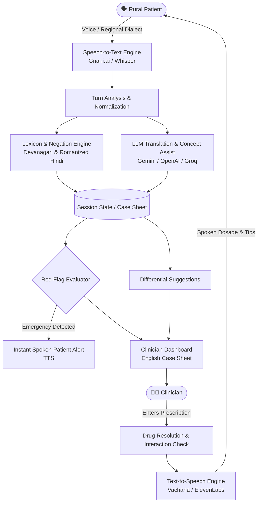

# GaonDoc

> **Voice Health Bridge for Rural Patients and Clinicians**  
> Bridging language, colloquialisms, and literacy barriers in rural primary healthcare consultations.

---

## 🌟 Overview

In rural and peri-urban healthcare settings across India, patients often speak colloquial Hindi, Hinglish, or regional dialects, while visiting physicians frequently consult and document in clinical English. Critical symptoms, timeframes, or red flags get missed across translation gaps.

**GaonDoc** is an ambient voice assistant and clinical decision support system:
1. **Patient Speaks**: Audio is transcribed in real-time in Hindi or regional languages.
2. **Clinical Analysis**: The system extracts clinical concepts, negation (*"bukhar nahi hai"*), durations (*"teen din se"*), and background facts.
3. **Bilingual Bridge**: Translates the consultation live for the clinician into English while maintaining medical accuracy.
4. **Safety & Alerts**: Flags clinical red flags across turns (e.g., pregnancy + vaginal bleeding, chest pain, stroke symptoms) and issues instant audible patient safety warnings.
5. **Prescription Safety**: Validates drug names against a clinical dispensary list, flags look-alike/sound-alike drugs, cross-checks allergies, and speaks localized medication instructions back to the patient.

> ⚠️ **Important Clinical Notice**: **GaonDoc is decision support only — it does not diagnose.** A qualified clinician reviews and confirms every output, prescription, and recommendation. Audio streams are processed in memory and never stored.

---

## 🏗️ Architecture & Pipeline Flow



---

## ✨ Key Features

- **Indic Voice-First Interface**: Real-time microphone capture with integrated PWA client supporting 12+ Indian languages (`hi`, `en`, `bn`, `ta`, `te`, `mr`, `gu`, `kn`, `ml`, `pa`, `ur`, `or`).
- **Negation & Duration Detection**: Built-in colloquial parser accurately isolates denials (*"sirf ulti hai, dast nahi"*), durations (*"do hafte se"*), and pediatric/geriatric ages.
- **Multiturn Emergency Cross-Check**: Red flags evaluate cumulative state (e.g., turn 1 confirms pregnancy, turn 3 mentions bleeding $\rightarrow$ immediate emergency alert).
- **Phonetic Medication Matching**: Resolves spoken or misspelled drug names to generic formulations, warning against dangerous sound-alikes and pregnancy contraindications.
- **Privacy by Design**: In-memory session store with automated TTL expiry; raw voice recordings are never stored to disk or cloud storage.
- **Config-Driven Extensibility**: Switch effortlessly between mock mode, OpenAI, Google Gemini, Groq, or enterprise Indian voice stacks (Gnani.ai / Vachana).

---

## 🚀 Quickstart

### Prerequisites
- Python 3.10 to 3.14
- Modern web browser (Chrome, Edge, Firefox, or Safari) with microphone permissions

### 1. Clone & Setup

```bash
git clone https://github.com/your-username/GaonDoc.git
cd GaonDoc
```

### 2. Install Dependencies

```powershell
# Windows PowerShell
py -m venv .venv
.\.venv\Scripts\Activate.ps1
pip install -r requirements.txt
```

```bash
# macOS / Linux
python3 -m venv .venv
source .venv/bin/activate
pip install -r requirements.txt
```

### 3. Run Locally

**Option A — Quick 1-Click Scripts:**
* Windows PowerShell: `.\run.ps1`
* Windows Batch: `run.bat`

**Option B — Direct Command:**
```bash
uvicorn app.main:app --reload --port 8000
```

Open **`http://localhost:8000`** in your browser.

> 💡 By default, GaonDoc runs in **`PROVIDER_MODE=mock`**. You can explore the full consultation flow with typed input, synthetic voice placeholders, and local rule extractors without needing API keys!

---

## ⚙️ Connecting Live AI Models

To enable live speech recognition, speech synthesis, and AI translation, create or edit `.env` in the root directory:

```env
PROVIDER_MODE=http
```

### Supported Provider Configurations

#### 🎙️ Speech-to-Text (STT)

| Provider | Configuration in `.env` |
|---|---|
| **Gnani.ai / Vachana** *(Recommended for Indic)* | `STT_URL=https://api.vachana.ai/stt/v3`<br>`STT_KEY=vach_...`<br>`STT_AUTH_HEADER=X-API-Key-ID`<br>`STT_AUTH_SCHEME=`<br>`STT_FILE_FIELD=audio_file`<br>`STT_LANG_FIELD=language_code`<br>`STT_TEXT_PATH=transcript`<br>`STT_LANG_MAP={"hi":"hi-IN","en":"en-IN"}` |
| **OpenAI Whisper** | `STT_URL=https://api.openai.com/v1/audio/transcriptions`<br>`STT_KEY=sk-...`<br>`STT_EXTRA={"model":"whisper-1"}`<br>`STT_TEXT_PATH=text` |
| **Groq Whisper** | `STT_URL=https://api.groq.com/openai/v1/audio/transcriptions`<br>`STT_KEY=gsk_...`<br>`STT_EXTRA={"model":"whisper-large-v3-turbo"}` |

#### 🔊 Text-to-Speech (TTS)

| Provider | Configuration in `.env` |
|---|---|
| **Gnani.ai / Vachana** *(Recommended for Indic)* | `TTS_URL=https://api.vachana.ai/api/v1/tts/inference`<br>`TTS_KEY=vach_...`<br>`TTS_AUTH_HEADER=X-API-Key-ID`<br>`TTS_AUTH_SCHEME=`<br>`TTS_VOICE=Nalini`<br>`TTS_EXTRA={"model":"timbre-v2.5","audio_config":{"container":"wav"}}`<br>`TTS_MIME=audio/wav` |
| **OpenAI TTS** | `TTS_URL=https://api.openai.com/v1/audio/speech`<br>`TTS_KEY=sk-...`<br>`TTS_TEXT_FIELD=input`<br>`TTS_VOICE_FIELD=voice`<br>`TTS_VOICE=alloy`<br>`TTS_EXTRA={"model":"tts-1"}` |

#### 🧠 Large Language Model (LLM) — Translation & Extraction

| Provider | Configuration in `.env` |
|---|---|
| **Google Gemini** | `LLM_URL=https://generativelanguage.googleapis.com/v1beta/openai/chat/completions`<br>`LLM_KEY=your_gemini_key`<br>`LLM_MODEL=gemini-3.5-flash`<br>`LLM_TEXT_PATH=choices.0.message.content` |
| **Groq (Llama 3.3)** | `LLM_URL=https://api.groq.com/openai/v1/chat/completions`<br>`LLM_KEY=gsk_...`<br>`LLM_MODEL=llama-3.3-70b-versatile` |
| **OpenAI** | `LLM_URL=https://api.openai.com/v1/chat/completions`<br>`LLM_KEY=sk-...`<br>`LLM_MODEL=gpt-4o-mini` |

---

## 📡 API Reference

| Method | Endpoint | Description |
|---|---|---|
| `GET` | `/api/health` | Health check, provider mode, and supported languages |
| `POST` | `/api/sessions` | Create a new consultation session (requires `consent: true`) |
| `POST` | `/api/sessions/{id}/turn` | Process audio or text turn (`speaker: patient\|doctor`) |
| `POST` | `/api/sessions/{id}/prescription` | Submit and audit doctor prescription (`prescriber_confirmed: true`) |
| `GET` | `/api/sessions/{id}/summary` | Retrieve doctor clinical summary and patient safety sheet |
| `POST` | `/api/medication/resolve` | Resolve phonetic or spoken medicine names |
| `DELETE`| `/api/sessions/{id}` | Discard and purge session from memory |

---

## 🧪 Testing & Evaluation

Run the unit test suite:
```bash
pytest
```

Run clinical evaluation metrics against bundled validation cases:
```bash
python -m eval.run_eval
```

Benchmark an STT provider against audio ground truth:
```bash
python -m eval.stt_benchmark eval/heldout.json --lang hi
```

The benchmark reports Word Error Rate (WER) alongside **Clinical Concept Recall & Precision**, measuring how accurately actual medical symptoms survive speech recognition.

---

## 📂 Project Structure

```text
GaonDoc/
├── app/
│   ├── config.py              # Environment configuration & .env loader
│   ├── main.py                # FastAPI endpoints & static file server
│   ├── schemas.py             # Pydantic request/response models
│   ├── session.py             # In-memory TTL session management
│   ├── data/
│   │   ├── conditions.json    # Clinical rule definitions & checks
│   │   ├── drugs.json         # Essential medication database & interactions
│   │   ├── medical_terms.json # Multilingual colloquial symptom lexicon
│   │   └── redflags.json      # Emergency red flag criteria
│   ├── pipeline/
│   │   ├── analyze.py         # Lexical parser & negation matcher
│   │   ├── consult.py         # Multi-turn consultation orchestrator
│   │   ├── differential.py    # Rule-based diagnostic suggestions
│   │   ├── llm_extract.py     # LLM concept fallback & supplementary pass
│   │   ├── medication.py      # Drug resolution & safety checker
│   │   ├── redflags.py        # Emergency rule engine
│   │   └── translate.py       # Clinical bilingual translator
│   ├── providers/
│   │   ├── base.py            # Abstract provider interfaces
│   │   ├── http_provider.py   # Universal HTTP adapters for STT, TTS, LLM
│   │   └── mock.py            # Local zero-key mock implementations
│   └── static/
│       ├── index.html         # Responsive, mobile-first Web App / PWA
│       ├── manifest.webmanifest
│       └── sw.js              # Offline-first service worker
├── eval/                      # Accuracy benchmark sets & evaluation scripts
├── tests/                     # 60+ pytest integration and unit tests
├── .env.example               # Configuration template
├── requirements.txt           # Python package dependencies
├── run.bat                    # Windows 1-click launch batch script
└── run.ps1                    # Windows 1-click launch PowerShell script
```

---

## ⚖️ License

Distributed under the MIT License. See `LICENSE` for more information.
